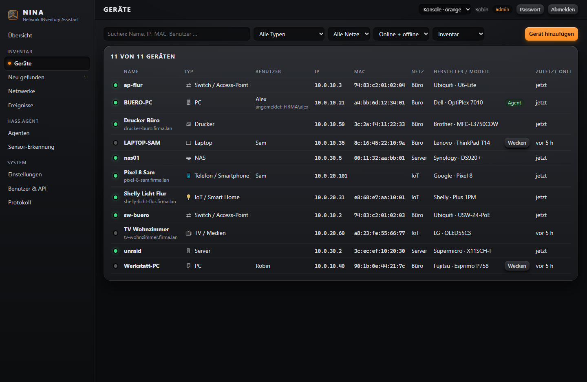
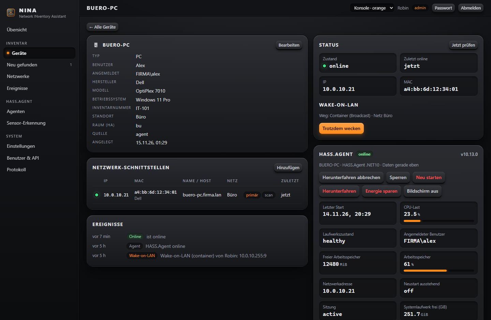

<p align="center"></p>

# NINA

**Network INventory Assistant** – Netzwerk- und IT-Geräteliste als Docker-Container für Unraid: Rechner und Netzwerkgeräte von Hand anlegen oder automatisch finden – per Scan in mehreren Netzen, über ARP/DHCP der OPNsense und über HASS.Agent. Mit Wake-on-LAN, Befehlen an die Rechner (Herunterfahren, Neustart, Sperren …) und einer Schnittstelle für Home Assistant.

Home-Assistant-Integration: [nina_ha_integration](https://github.com/SysriX/nina_ha_integration) · Weitere Unraid-Pakete: [MIRA](https://github.com/SysriX/mira_unraid), [haproxy-unraid](https://github.com/SysriX/haproxy_unraid), [haproxy-ui](https://github.com/SysriX/haproxy-ui_unraid), [certwarden-unraid](https://github.com/SysriX/certwarden_unraid)

`ghcr.io/sysrix/nina:latest`



*Beispieldaten*

> **Stand 1.0.0:** erste Version. Lokal getestet: Einrichtung, Anmeldung, Ping-Scan in einem echten Netz, Geräte/Schnittstellen/Netzwerke, Wake-on-LAN (Container-Broadcast), API für Home Assistant, Schema-Migration. HASS.Agent .NET10 mit echten aufgezeichneten Nachrichten geprüft (Befehle nur an einen Test-Stub). **Noch nicht gegen echte Systeme getestet:** nmap im Container, OPNsense-API (ARP/DHCP/WoL), Live-MQTT-Verbindung, MariaDB.

## Was es kann

| Bereich | Inhalt |
| --- | --- |
| **Geräte** | Name, Typ (PC, Laptop, Server, NAS, Switch/AP, Router, Drucker, Telefon, IoT …), **Benutzer** (wer daran arbeitet), angemeldeter Benutzer (vom HASS.Agent), Hersteller, Modell, Betriebssystem, Serien-/Inventarnummer, Standort, Raum-Kürzel für HA, Schlagwörter, Notizen, **eigene Zusatzfelder** |
| **Schnittstellen** | je Gerät beliebig viele: IP, MAC, Hostname, MAC-Hersteller, Netz, primär, feste IP |
| **Netzwerke** | mehrere Netze/VLANs, je Netz Scan an/aus, Intervall, Methode (nmap, Ping, nur OPNsense) und Wake-on-LAN-Weg |
| **Automatisch finden** | nmap/Ping-Scan (im eigenen Netz mit MAC), **OPNsense** ARP-Tabelle + DHCP-Leases (ISC, Kea, Dnsmasq) für alle VLANs, **HASS.Agent**. Neue Geräte landen unter „Neu gefunden“ (übernehmen, ignorieren, zusammenführen) oder direkt im Inventar; Typ wird aus Hersteller/Hostname geraten |
| **Online-Status** | aus Scans, ARP, Ping-Überwachung (einstellbar je Gerät) und HASS.Agent; Ereignis-Verlauf (neu, online/offline, IP geändert, WoL, Befehle) |
| **Wake-on-LAN** | wahlweise **aus dem Container** (Broadcast ins eigene Netz bzw. gerichteter Broadcast) oder **über die OPNsense** (Plugin os-wol) in andere Netze, oder beides; automatisch je Netz |
| **HASS.Agent** | klassischer HASS.Agent (MQTT-Discovery) **und HASS.Agent .NET10** (eigenes MQTT-Protokoll `hass.agent/…`). Infokarte je Rechner mit Live-Werten (CPU, RAM, Laufwerk, Laufzeit, angemeldeter Benutzer …) und allen Befehlen, die der Agent anbietet |
| **Sensor-Erkennung** | Namensmuster (`*cpu*`, `re:…`) ordnen Sensoren und Befehle ein: deutsche Bezeichnung, Einheit, Geräteklasse, Symbol, ob sie an Home Assistant gehen, ob ein Befehl eine Rückfrage braucht |
| **Home Assistant** | Ankündigung per **mDNS** (`_nina._tcp`), API mit Schlüsseln (`/api/ha/v1`), passende Integration legt Geräte, Sensoren, Knöpfe und Dienste an |
| **Benutzer** | Rollen Leser / Operator / Admin, API-Schlüssel, Protokoll aller Aktionen |
| **Aussehen** | wie MIRA: Konsole (Orange · Grün · Blau), Dunkel, Hell, wie das System |

## Installation in Unraid

1. Vorlage holen und in **Apps › Private** `NINA` installieren:
   ```bash
   mkdir -p /boot/config/plugins/community.applications/private/sysrix && curl -fsSL https://raw.githubusercontent.com/SysriX/nina_unraid/main/templates/nina.xml -o /boot/config/plugins/community.applications/private/sysrix/nina.xml
   ```
2. Netzwerk **`br0` mit fester IP** im Netz der Rechner – nur dann sieht der Scan MAC-Adressen, kommt der WoL-Broadcast an und findet Home Assistant den Dienst per mDNS. Die Vorlage gibt `NET_RAW`/`NET_ADMIN` für nmap.
3. Ordner `appdata/nina` → `/config`.
4. Starten, im **Log** steht der **Einrichtungs-Code**, dann `http://<IP_NINA>:8080` öffnen.

### Einrichtungs-Assistent

1. **Code** aus dem Log.
2. **Datenbank**: eingebaut (SQLite) oder **MariaDB** (vorhandene Datenbank, oder mit Root-Zugang Datenbank + Benutzer anlegen lassen). Liegt dort schon eine NINA-Datenbank, wird sie übernommen.
3. **Admin** anlegen (oder vorhandene Benutzer übernehmen) und optional das erste Netz.

Danach unter **Netzwerke** alle Netze/VLANs eintragen und unter **Einstellungen** MQTT (HASS.Agent) und OPNsense.

## Anbindungen

| Quelle | Einrichtung |
| --- | --- |
| **HASS.Agent** | Einstellungen › MQTT: der Broker, den HASS.Agent und Home Assistant nutzen (z. B. Mosquitto-Add-on, am besten eigener Benutzer). NINA liest mit und sendet Befehle wie Home Assistant. Agenten werden über den Namen mit vorhandenen Geräten verknüpft (sonst neues Gerät), doppelt gefundene Scan-Einträge werden über MAC/IP zusammengeführt. |
| **OPNsense** | System › Zugang › Benutzer: API-Benutzer mit „Diagnostics: ARP Table“, DHCP-Leases (ISC/Kea/Dnsmasq), „Services: Wake on LAN“, „Interfaces“; API-Schlüssel erzeugen. Für WoL das Plugin **os-wol** installieren und bei jedem Netzwerk die Schnittstelle (`lan`, `opt1` …) wählen. |
| **Home Assistant** | Benutzer & API › Schlüssel erzeugen. Integration [nina_ha_integration](https://github.com/SysriX/nina_ha_integration) installieren – HA meldet „NINA gefunden“ (mDNS, gleiches Netz) oder von Hand Host/Port eintragen. |

### HASS.Agent-Befehle aus Automationen

Über die HA-Integration: Knopf je Befehl (`button.<raum>_net_<gerät>_shutdown` …) oder der Dienst `nina_inventory.command` mit `command: shutdown | restart | sleep | hibernate | lock | logoff | wake …`. Bei HASS.Agent .NET10 bestimmt `value` die Verzögerung von Herunterfahren/Neustart in Sekunden (Standard 60, abbrechbar mit `restart_cancel`).

## Datenbank, Updates, Erweiterungen

- Das Schema hat eine **Versionsnummer** (`ni_schema`). Ein neueres Image zieht die Datenbank beim Start selbst nach (`app/migrationen.py`, je Version ein Schritt); SQLite wird vorher als `<datei>.vor-v<alt>` kopiert. Ein **älteres** Image startet nicht mit einer neueren Datenbank.
- **Zusatzfelder** (Einstellungen › Allgemein) erweitern Geräte ohne Schema-Änderung (Spalte `extra`, JSON) – auch an Home Assistant übergeben.
- **Sicherung** (Einstellungen › Datenbank & Sicherung): Export/Import als JSON (Netzwerke, Geräte, Schnittstellen, Muster). Bei MariaDB zusätzlich `mysqldump`.
- Die HA-API ist versioniert (`/api/ha/v1`); brechende Änderungen kämen als `v2` neben `v1`.
- Entwickeln: siehe [ENTWICKLUNG.md](ENTWICKLUNG.md).

## Umgebungsvariablen

| Variable | Standard | Bedeutung |
| --- | --- | --- |
| `NINA_DATA` | `/config` | Datenordner |
| `NINA_PORT` | `8080` | Port der Weboberfläche/API |
| `NINA_ADRESSE` | automatisch | IP für die mDNS-Ankündigung |
| `NINA_MDNS` | `1` | `0` = keine mDNS-Ankündigung |
| `NINA_PROXY_IPS` | `127.0.0.1` | Reverse-Proxy, dem `X-Forwarded-*` geglaubt wird |
| `NINA_KEY` | – | Fernet-Schlüssel statt `/config/schluessel.key` |
| `NINA_SETUP_TOKEN` | – | fester Einrichtungs-Code |
| `NINA_TLS_CERT` / `NINA_TLS_KEY` | – | HTTPS direkt im Container |

Zugangsdaten (MQTT, OPNsense, MariaDB) liegen **verschlüsselt** in der Datenbank; der Schlüssel `/config/schluessel.key` gehört **mit in die Sicherung**.

## Lizenz

MIT
